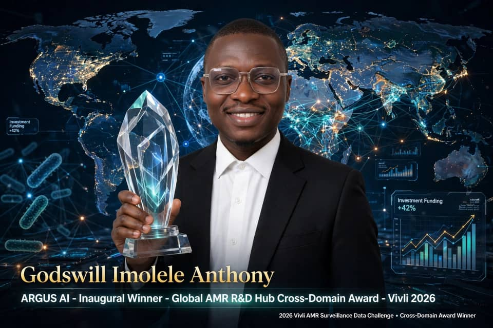

::: {.columns}

:::: {.column width="35%"}

{width=100% fig-alt="Portrait of Godswill Imolele Anthony"}

::::

:::: {.column width="65%" .hero-text}

# Godswill Imolele Anthony

### Bayesian AI · Antimicrobial Resistance · Drug Discovery

*Every antibiotic is a conversation with four billion years of evolution. I build models that know the limits of what they know, so that when we act on that conversation, we act with open eyes.*

Understanding why predictive models fail across populations may reveal more about disease biology than understanding why they first succeed. I develop uncertainty-aware, interpretable computational methods that turn uneven, incomplete biological and surveillance data into evidence people can trust and act on.

Team lead of **Argus AI**, winner of the **[Global AMR R&D Hub Cross-Domain Award](https://amr.vivli.org/argus-ai-detecting-global-amr-innovation-burden-mismatch-with-bayesian-evidence-synthesis/)** at the 2026 Vivli AMR Surveillance Data Challenge. Bioinformatics Associate at BioSeq; Project Lead at the Helix Biogen Institute, Nigeria. Applying for PhD positions in [FIELD] starting [YEAR].

::: {.buttons}
[Research](research.qmd){.btn .btn-primary}
[Projects](projects.qmd){.btn .btn-outline-primary}
[Publications](publications.qmd){.btn .btn-outline-primary}
[Download CV](files/Godswill_Imolele_Anthony_CV%20(1).pdf){.btn .btn-outline-secondary}
:::

::::

:::

---

::: {.columns}

::: {.column width="25%"}
### 4.95 million
isolate–drug observations in a Bayesian hierarchical synthesis
:::

::: {.column width="25%"}
### 71 countries
44 species, ten antibiotics, 2004–2024
:::

::: {.column width="25%"}
### 2 Vivli placements
Finalist (top 10% of 100+ teams), then Cross-Domain Award
:::

::: {.column width="25%"}
### 2 first-author papers
Machine-learning drug discovery for tuberculosis and GRK5
:::

:::

---

## Three things you can open right now

::: {.columns}

::: {.column width="33%"}
### Argus AI
Where do the biggest resistance threats and the weakest R&D response coincide? Bayesian evidence synthesis with built-in sensitivity analyses.

[Live dashboard](https://argus-framework.streamlit.app/) · [Official award entry](https://amr.vivli.org/argus-ai-detecting-global-amr-innovation-burden-mismatch-with-bayesian-evidence-synthesis/)
:::

::: {.column width="33%"}
### ResistAI+
How fast is resistance changing, how confident can we be, and when will thresholds be crossed? Change-points, MIC creep and forecasts with intervals.

[Live dashboard](https://resistaiplus.streamlit.app/)
:::

::: {.column width="33%"}
### NaijaResist
What happens when phenotype and genotype disagree? Machine-learning prediction for Nigeria that makes discordance visible and reviewable.

[Live dashboard](https://naijaresist.streamlit.app/)
:::

:::

*The dashboards run on free hosting, so one that has been idle may take around 30 seconds to wake.* [All projects →](projects.qmd)

---

## What I work on

Bayesian hierarchical modelling · AMR surveillance and forecasting · genotype–phenotype reconciliation · machine-learning drug discovery · pathogen and infection genomics · reproducible, auditable pipelines

[Read the research programme →](research.qmd)

---

## Recent

- **Oct 2026:** Joined BioSeq LTD as Bioinformatics Associate (Level 3), working on infection genomics and AMR data integration.
- **2026:** Argus AI received the Global AMR R&D Hub Cross-Domain Award at the Vivli AMR Surveillance Data Challenge.
- **2026:** First-author paper on machine-learning discovery of InhA inhibitors published in *Biology Methods and Protocols* ([DOI](https://doi.org/10.1093/biomethods/bpag015)).
- **2025:** ResistAI+ named finalist (top 10% of 100+ teams) at the Vivli AMR Surveillance Global Data Challenge.
- **2025:** Winner, Advanced CADD Machine-Learning Drug Discovery Challenge.

<!-- ADD AFTER CHECKING THE COMPETITION'S RULES AND RESULTS
- **2026:** Led team Morph-HSV in the preliminary round of the Shanghai Computational Biology competition.
-->

---

*[About](about.qmd) · [Experience](experience.qmd) · [ORCID](https://orcid.org/0000-0002-3093-3309) · [anthonyimolele@gmail.com](mailto:anthonyimolele@gmail.com)*