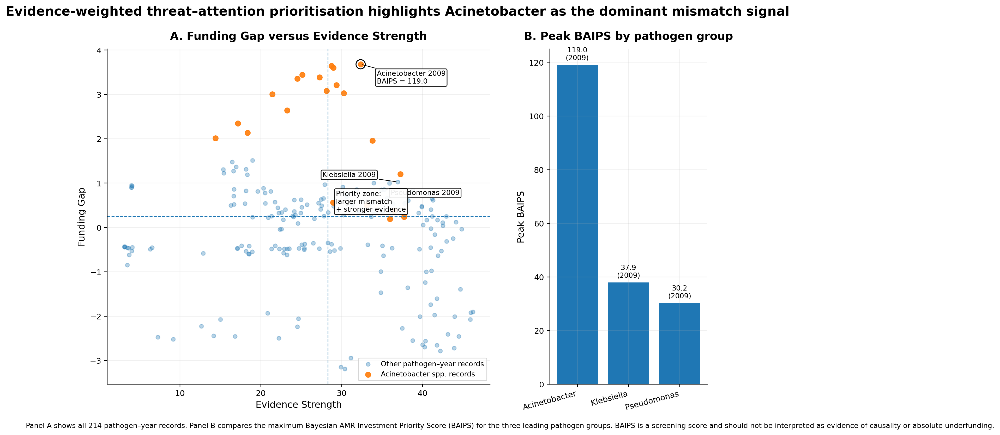

Most tools for antimicrobial resistance (AMR) tell you what has happened. The ones I build also tell you **how sure they are**, **where their data run out**, and **where the sources disagree**. The projects below follow that idea from global surveillance to a single protein pocket.

| Project | Question it answers | Role | Live | Code |
|---|---|---|---|---|
| **Argus AI** | Where do the biggest resistance threats and the weakest R&D response coincide? | Project lead | [Dashboard](https://argus-framework.streamlit.app/) | [GITHUB-LINK] |
| **ResistAI+** | How fast is resistance changing, how confident can we be, and when will thresholds be crossed? | Team lead | [Dashboard](https://resistaiplus.streamlit.app/) | [GITHUB-LINK] |
| **NaijaResist** | Can resistance in Nigeria be predicted, and what happens when phenotype and genotype disagree? | Project lead and architect | [Dashboard](https://naijaresist.streamlit.app/) | [GITHUB-LINK] |
| **InhA inhibitor discovery** | Which natural products could inhibit a tuberculosis target, and how reliable is the model that says so? | First and corresponding author | [Paper](https://doi.org/10.1093/biomethods/bpag015) | [GITHUB-LINK] |

*All three surveillance systems were developed at the Helix Biogen Institute. The dashboards run on free hosting, so one that has been idle may take around 30 seconds to wake. Please give it a moment.*

---

# Surveillance and decision systems

## Argus AI: where the threat and the response fail to meet

**Global AMR R&D Hub Cross-Domain Award, 2026 Vivli AMR Surveillance Data Challenge** · Project lead, Helix Biogen Institute · [Open dashboard](https://argus-framework.streamlit.app/)

### The problem

AMR burden, resistance mechanisms, surveillance capacity, research funding and drug-development activity are usually assessed separately. That makes it hard to see whether the greatest threats are getting proportionate scientific and financial attention.

{width=100% fig-alt="Argus AI result summary"}

### What I built

A Bayesian hierarchical evidence synthesis of **4.95 million isolate–drug observations** (71 countries, 44 species, ten antibiotics, 2004–2024), combined with global AMR R&D investment data. The framework integrates:

- Bayesian burden–funding alignment, with partial pooling so sparse countries borrow strength without being treated as identical
- Isolate-weighted and country-balanced sensitivity analyses, so conclusions do not hinge on one modelling choice
- Resistance-mechanism intelligence and drug-pipeline performance
- Surveillance-equity diagnostics and policy-effect analysis
- Citation-grounded AI evidence retrieval, with versioned data lineage so every claim can be traced to its source

### What it shows

Where resistance burden, therapeutic vulnerability, scientific attention and investment are most dangerously misaligned, and how much that conclusion depends on how the data are weighted.

![Argus AI dashboard: [ADD A ONE-LINE CAPTION OF WHAT THIS PANEL SHOWS]](images/Argu.jpeg){fig-alt="Argus AI dashboard overview"}

![Argus AI dashboard: [CAPTION]](images/Argu2.jpeg){fig-alt="Argus AI burden and funding alignment view"}

![Argus AI dashboard: [CAPTION]](images/Argu3.jpeg){fig-alt="Argus AI surveillance-equity diagnostics view"}

**Limits I am explicit about:** surveillance data are unevenly sampled, and absence of reported resistance is not evidence of absence. The sensitivity analyses exist to show where conclusions are fragile.

---

## ResistAI+: resistance with error bars and a forecast

**Finalist, top 10% of 100+ teams, 2025 Vivli AMR Surveillance Global Data Challenge** · Team lead, data analysis and deployment, Helix Biogen Institute · [Open dashboard](https://resistaiplus.streamlit.app/)

### The problem

Most AMR platforms describe where resistance has occurred. Few say how confidently it can be estimated, why it may be changing, or where it may emerge next.

### What I built

An interactive platform on Pfizer ATLAS data (2004–2023) that combines:

- Bayesian hierarchical modelling of temporal and geographic variation in non-susceptibility
- Change-point detection and MIC-creep analysis for levofloxacin, meropenem and linezolid
- Resistance-risk prediction and posterior-predictive, time-to-threshold forecasting
- Causal analysis using directed acyclic graphs
- Policy-priority analytics across countries

### What it shows

Not only which resistance patterns exist, but how much each estimate can be trusted, when trends shifted, and which settings deserve attention first.

![ResistAI+ interface: [CAPTION]](images/Re.jpeg){fig-alt="ResistAI+ dashboard"}

![Policy-priority heatmap from ResistAI+: [CAPTION]](images/ResistAI_Policy_Priority_Heatmap_HD.png){fig-alt="ResistAI+ policy priority heatmap"}

**Limits I am explicit about:** the causal graphs encode assumptions, and the forecasts are conditional on trends continuing. The dashboard shows intervals, not single numbers, for this reason.

---

## NaijaResist: prediction that shows where the evidence disagrees

**Prototype** · Project lead and architect, Helix Biogen Institute · [Open dashboard](https://naijaresist.streamlit.app/)

### The problem

Surveillance in Nigeria is fragmented across hospitals, laboratories, pathogens and regions. Where phenotypic resistance and genetic evidence disagree, most pipelines quietly pick one and move on. And without integration, emerging hotspots are hard to see.

### What I built

A prototype AMR intelligence system for Nigeria that combines two things usually kept apart:

- **Prediction and trends:** machine-learning resistance prediction, geographic and temporal trend analysis, epidemiological forecasting and pathogen–antibiotic profiling
- **Genotype–phenotype reconciliation:** phenotypic resistance, gene burden, cross-species transfer and organism-level threat are reconciled, and **discordance is flagged so that it is visible and reviewable** rather than hidden

### What it shows

Where the models and the genomic evidence agree, where they diverge, and which divergences deserve an expert's attention. Often that is where the most interesting biology, or the most important data-quality problem, sits.

![NaijaResist interface: [CAPTION]](images/NaijaRe.jpeg){fig-alt="NaijaResist dashboard overview"}

![NaijaResist interface: [CAPTION]](images/NaijaRe2.jpeg){fig-alt="NaijaResist discordance and trend view"}

**Limits I am explicit about:** this is a prototype built on the data currently available, and it is designed to support review by experts, not to replace it.

---

# Computational drug discovery

## Natural-product inhibitors of InhA, a tuberculosis target

**First and corresponding author** · *Biology Methods and Protocols* (2026) · [Paper](https://doi.org/10.1093/biomethods/bpag015) · [GITHUB-LINK]

I developed a machine-learning-driven QSAR and structural-bioinformatics workflow for screening natural products against InhA. It integrates molecular descriptors, model evaluation, docking and molecular dynamics. The aim was a pipeline in which each step's reliability can be examined, not only a ranked list of candidates.

![Structural stability of the top-ranked hits over a 100 ns molecular dynamics simulation. RMSD of the InhA apo form (black) and four top-hit complexes (LTS0023082, LTS0064866, LTS0078946, LTS0161715) settles after roughly 40 ns and stays within a narrow band of about 2 to 3 Å for the remainder of the run, comparable to the unliganded protein. [STATE WHAT RMSD IS CALCULATED ON, E.G. PROTEIN BACKBONE.]](images/inha_rmsd.png){fig-alt="Line plot of RMSD in angstroms against time in nanoseconds for InhA apo and four ligand complexes over 100 ns"}

## 4-quinolone ligands and GRK5

**First author** · *Egyptian Journal of Medical Human Genetics* (2025) · [Paper](https://doi.org/10.1186/s43042-025-00780-x)

An in silico evaluation of 4-quinolone ligands interacting with GRK5, combining message-passing neural networks, molecular docking and molecular dynamics.

## Winner, 2025 Advanced CADD Machine-Learning Drug Discovery Challenge

Led the field on enrichment factor and error performance in an international West African cohort. [ADD ONE SENTENCE ON YOUR MODEL AND TARGET]

## Contributing author: *Trypanosoma cruzi* and Lassa virus

- **Sterol 14α-demethylase inhibitors for *T. cruzi*** (contributing author, *In Silico Research in Biomedicine*, 2026): integrative machine learning and structural bioinformatics for selective inhibitors. [Paper](https://doi.org/10.1016/j.insi.2026.100182)
- **Epitope-based vaccine candidate for Lassa mammarenavirus** (co-author, *Journal of Biomolecular Structure and Dynamics*, 2022): immunoinformatics using strains from Nigeria. [Paper](https://doi.org/10.1080/07391102.2021.1896387)

---

# Translational and clinical genomics

## HLA class I and survival

Integrated transcriptomic, whole-genome, immune and clinical data into Cox proportional-hazards models and found that low HLA class I expression predicts poorer outcomes. Analysed RNA-seq and microarray data from a Sri Lankan nasopharyngeal carcinoma cohort using DESeq2, limma and gene-set enrichment.

## Ebola Zaire diagnostic target discovery

Identified a gap in Ebola Zaire strain diagnosis, then led a collaborative project to select and analyse immunogenic genes and design a potential construct for a lateral-flow diagnostic test kit.

---

# Where these projects point

The same question runs through all of them: **how do we make computational biology honest enough to guide decisions about infection?** I am looking for a PhD in which these systems can be tested against experimental and genomic ground truth, and extended to settings where data are sparse and the burden is greatest.

::: {.callout-note appearance="simple"}
## Collaboration
I welcome conversations with groups working on AMR surveillance, pathogen genomics, Bayesian methods or drug discovery.

[Email me](mailto:anthonyimolele@gmail.com) · [Experience](experience.qmd) · [Publications](publications.qmd) · [About](about.qmd)
:::